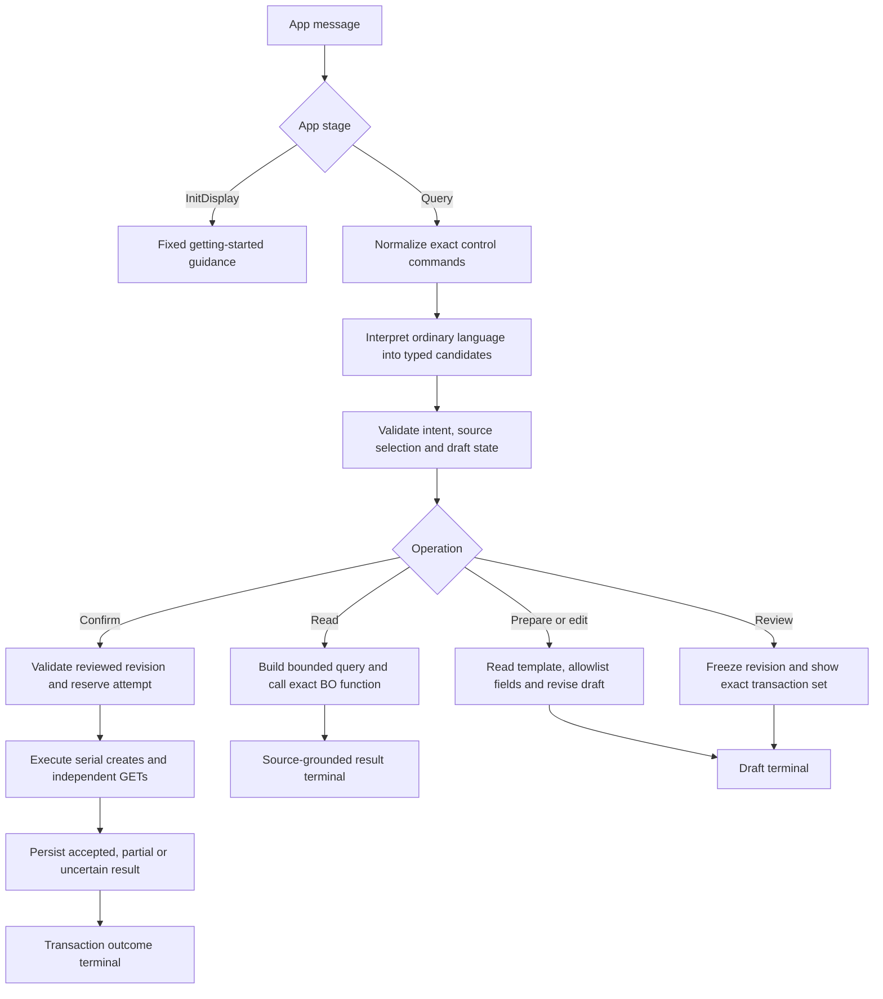

# XDX Supplier Workspace — conversational lookup and template-based creation

Date: 2026-10-14. Status: written design for user review; implementation has not started.

## 1. Intended outcome and agreed scope

Procurement supplier administrators use the Ask Oracle box **inside this app** to find suppliers, inspect their addresses, sites and contacts, and prepare new suppliers or sites from approved fields of existing active records. Existing signed-in-user permissions and business-unit access govern all operations. A creation request prepares a draft; a separate explicit confirmation commits the exact reviewed revision.

The opening displays only:

> Get started by searching for a supplier. Just say: “Find a supplier like Dell.”

Startup performs zero supplier/business-record reads. It does not display a supplier list, dashboard metrics, or personalized claims. Generic navigation context may be supplied by the app shell, but it is never treated as supplier data.

Confirmed decisions from the grilling interview:

| Decision | Required behavior |
| --- | --- |
| Entry and user | App-local Ask Oracle; supplier administrators using existing permissions |
| Reads | Supplier search/detail; supplier addresses, sites and contacts; assignments needed for site preparation and verification |
| Supplier creation | Existing supplier as template; new user-supplied name; inherit only supplier type, business relationship and tax organization type |
| Site creation | Same selected supplier, existing same-parent address, procurement BU and purchasing-purpose setting as the source site; new user-supplied site name |
| Assignments | Include applicable source client-BU/bill-to-BU pairs in the reviewed site draft; execute through separate assignment operations |
| Confirmation | Show inherited, edited and omitted fields; allow revisions; require explicit confirmation of the reviewed revision |
| Ambiguity | Present candidates and require selection whenever more than one record matches |
| Duplicate names | Block and ask for another name; no automatic suffixing or update/upsert |
| Status | Active-only default; explicit inactive-record queries allowed; inactive records cannot be creation templates |
| Partial outcome | Preserve a created site; report assignments incomplete; separately confirm continuation for verified missing assignments |

Creation of addresses or contacts, updates/deletes, tax/legal/bank data cloning, payments, flexfields, attachments, spend authorization actions and global Fusion Ask integration are outside this release. The app does not copy supplier children when creating a supplier. It does not send communications or notifications. A site's procurement-BU and assignment records are not a promise that every purchasing/payment prerequisite outside this approved field set is configured.

## 2. Sources and API selection

Use the sibling Supplier operation library's `DIRECTORY.md`, branch directories and `operation-manifest.json` to select the exact operation. Read that operation's guide, notes and `contract.json`, then reconcile the matching repository object reference. There is no assumed clone endpoint: templates are reads followed by a separately validated create request.

Local contracts are Oracle Procurement 26C snapshots, REST version `11.13.18.05`. On 2026-10-14, the documentation tool could access the app-anatomy page but could not access the three exact 26C create pages. Search results included different releases and negotiation resources; none were substituted. Before implementation freezes the API contract, confirm the configured target release and retrieve its exact operation specification through a supported read-only route. Preserve disagreements with tenant/BO evidence. See the [source review](../../builds/xdx-supplier-conversation-design-20261014/source-review.json).

Oracle documents app-local Ask Oracle as querying the app's included agents: [26C app anatomy](https://docs.oracle.com/en/cloud/saas/fusion-ai/26c/aiaas/anatomy-of-an-agentic-app.html). This design makes no claim that publishing the app installs a global-header integration.

All paths below begin with `/fscmRestApi/resources/11.13.18.05`.

| Function responsibility | Method and relative path | Keys and use |
| --- | --- | --- |
| Supplier search/number resolution/duplicate preflight | GET `/suppliers` | Allowlisted `q`, fields, ordering and paging; no path IDs |
| Supplier detail/template/readback | GET `/suppliers/{SupplierId}` | Verified internal SupplierId |
| Supplier create | POST `/suppliers` | Reviewed writable supplier payload |
| Address list | GET `/suppliers/{SupplierId}/child/addresses` | Verified selected supplier |
| Address detail/reference validation | GET `/suppliers/{SupplierId}/child/addresses/{SupplierAddressId}` | Same-parent address key |
| Contact list | GET `/suppliers/{SupplierId}/child/contacts` | Verified selected supplier |
| Contact detail | GET `/suppliers/{SupplierId}/child/contacts/{SupplierContactId}` | Same-parent contact key |
| Site list/source selection/duplicate preflight | GET `/suppliers/{SupplierId}/child/sites` | Selected supplier; explicit BU context for source selection |
| Site detail/template/readback | GET `/suppliers/{SupplierId}/child/sites/{SupplierSiteId}` | Verified same-parent site key |
| Site create | POST `/suppliers/{SupplierId}/child/sites` | Reviewed name, procurement BU, address reference and purchasing purpose |
| Assignment list/source preparation/reconciliation | GET `/suppliers/{SupplierId}/child/sites/{SupplierSiteId}/child/assignments` | Verified site under verified supplier |
| Assignment detail/readback | GET `/suppliers/{SupplierId}/child/sites/{SupplierSiteId}/child/assignments/{AssignmentId}` | Generated/reconciled assignment key |
| Assignment create | POST `/suppliers/{SupplierId}/child/sites/{SupplierSiteId}/child/assignments` | Reviewed client-BU/bill-to-BU pair |

The 13 selected local contracts contain no unresolved schema references. This establishes local source structure, not tenant availability, permissions or saved-BO acceptance.

Object contract owners: [Suppliers](../../lessons/objects/oracle-fusion-procurement-suppliers.md), [Addresses](../../lessons/objects/oracle-fusion-procurement-supplier-addresses.md), [Contacts](../../lessons/objects/oracle-fusion-procurement-supplier-contacts.md), [Sites](../../lessons/objects/oracle-fusion-procurement-supplier-sites.md), and [Site assignments](../../lessons/objects/oracle-fusion-procurement-supplier-site-assignments.md). The [object registry](../../lessons/objects/README.md) and [living playbook](../../lessons/AI_STUDIO_AGENT_APP_LIVING_BUILD_PLAYBOOK.md) remain canonical.

## 3. Architecture choice

Three approaches were considered:

| Approach | Assessment |
| --- | --- |
| One app-backed workflow with explicit read/transaction routes and deterministic write gates | Selected. Keeps source bindings, transaction state and outcomes inspectable; avoids unproven child-workflow execution boundaries |
| A general tool-using agent with read and write tools | Conditional reads are convenient, but model tool selection must not own exact-revision approval, reservation or retry decisions. Adds an unnecessary write-authorization boundary for this release |
| A supervisor calling separate child workflows for each resource | Can provide reusable interfaces later; first requires proof of child lifecycle/status and response envelopes. Not justified for the initial scope |

Proposed artifacts, to create only after design and implementation-plan approval:

| Artifact | Code / filename | Owner |
| --- | --- | --- |
| App | `XDX_SUPPLIER_WORKSPACE` / `xdx_supplier_workspace.app` | Guidance and one supplier conversation/result panel |
| App-backed workflow | `XDX_SUPPLIER_CONVERSATION` / `xdx_supplier_conversation.wf` | Interpretation, routes, declared conversation state, draft review, transaction dispatch and terminal outcomes |
| Supplier BO | `XDX_SUPPLIERS` / `xdx_suppliers.bo` | Parent search/detail/create |
| Address BO | `XDX_SUPPLIER_ADDRESSES` / `xdx_supplier_addresses.bo` | Address reads only |
| Contact BO | `XDX_SUPPLIER_CONTACTS` / `xdx_supplier_contacts.bo` | Contact reads only |
| Site BO | `XDX_SUPPLIER_SITES` / `xdx_supplier_sites.bo` | Site reads/create |
| Assignment BO | `XDX_SUPPLIER_SITE_ASSIGNMENTS` / `xdx_supplier_site_assignments.bo` | Assignment reads/create |

Before creating BOs, reconcile the current local artifact inventory; reuse a compatible approved BO if one is present. The prior retained `aiapps/` inventory had no `/suppliers` BO. No new app-package exists in that baseline; recheck layout in the fresh implementation worktree before selecting final source paths. New display names use the `XDX` prefix.

Use one top-level panel agent for ordinary app-local Query handling; a separate `queryAgent` is unnecessary. The approved scope supports contextual conversational suggestions to inspect addresses/sites/contacts, prepare a supplier/site draft, review it, cancel it and confirm it. Implement these as documented exact conversation commands. No unimplemented clickable action is shown, and no InvokeAction route is implied by this conversational-only release. Summary participation is disabled unless a separately supported current-result summary is explicitly designed; no dedicated summary/subtitle agent or dynamic startup recommendations.

Exact review/confirmation/cancel commands are handled deterministically before ordinary language interpretation; the extractor does not reinterpret those commands. LLM interpretation produces typed candidates, never raw REST queries or write authorization. Deterministic nodes perform mechanical field mapping, escaping, bounds, state transitions and payload comparison. Retrieved records and user text are untrusted data in model prompts. Fixed startup and structured outputs use supported app-experience terminal nodes; where an LLM terminal is required, it passes through prebuilt content without changing fields or commands.

Every Query returns within one execution. Reachable HUMAN/WAIT nodes are forbidden; a later user message is a new Query operating on declared conversation state. Reuse is by BO contracts and deterministic ownership, not speculative adapter workflows.

## 4. Search, selection and related reads

“Find a supplier like Dell” means a case/escaping-compatible **contains** search, not semantic fuzzy matching. Exact names and displayed supplier numbers have explicit lookup routes. The actual supported query syntax must pass known-hit saved-BO checks; number lookup is not accepted merely because name search works.

Active-only filtering follows source status/date semantics verified for the target resource. Do not equate non-null InactiveDate with inactive: retained active address examples contain a far-future date. Explicit inactive queries display status prominently and never enable template selection. If current status cannot be established, withhold creation eligibility.

Return candidate name, displayed supplier number, status and selection command. Distinguish SupplierNumber from SupplierId. Preserve verified decimal identifier values without precision loss; apply request-specific numeric types only where required. A unique candidate can resolve a named query; multiple candidates require user selection. Source sites are scoped by parent supplier and shown with procurement BU, physical address and status. Never choose the first match to authorize creation.

Default collection page size is 25 with deterministic key ordering. Each result shows returned count, continuation state and an exact next-page command. A new filter or parent resets its cursor. The command preserves resource, parent, filter and offset and remains usable as the first Query after startup. Never call a first page “all records.” An explicit request for all uses bounded pagination with a visible incomplete outcome if the safety bound is reached; it does not silently truncate. No unrelated child collections are fetched unless the query or draft requires them.

Address/contact/site detail reads remain independent of supplier detail. Empty successful responses, unavailable data and transport/service errors have different outcomes. Contact views show only requested business contact fields; account/security and unrelated personal details are not included automatically. No credentials enter user responses, test fixtures or evidence.

## 5. Draft contracts

### New supplier based on Dell

Resolve an active supplier; read its scalar profile. Require a new supplier name rather than generate one. Copy only SupplierType, BusinessRelationship and TaxOrganizationType when supplied by the verified source and writable under the current contract. Missing classification values are explicit missing inputs; do not invent defaults. Preserve every agreed field through lookup validation and show inherited values for editing.

Omit generated SupplierId, SupplierNumber and SupplierPartyId only after reconciling target numbering behavior. The local 26C schema marks the latter two required while its examples omit them; retained generation evidence is tenant-scoped. Historical display-field success followed by a display-value rejection means code/display mapping must be verified before the create function is accepted. Use one validated representation for each field, not both code and label fields. No source legal/tax identifier, bank, contact, child, audit or security field is copied.

### New Round Rock 2 site for Dell

Resolve active Dell and an active unambiguous Round Rock site. Read that site's profile, verify its existing address belongs to Dell and is active, and enumerate applicable source assignments completely. Draft fields are: new SupplierSite name, source ProcurementBUId, exact existing address reference supported by the target POST contract, and source SitePurposePurchasingFlag. Display the address and BU labels alongside their verified references. No new address is created and no reference from another supplier is accepted.

Do not copy pay/primary-pay flags, payment terms, bank/tax configuration, holds, tolerances, communication settings, audit data, flexfields or attachments. This is the approved purchasing template field set, not a clone of every setting. The source purchasing-purpose value is preserved; if that value or tenant condition makes the requested site unusable for this approved purpose, block review with a specific explanation rather than silently change it.

Each assignment draft contains the applicable source ClientBUId and BillToBUId after current eligibility/access verification; do not replace BillToBU with ProcurementBU or assume the IDs are equal. Existing duplicate pairs are deduplicated for planned transactions without claiming a universal service uniqueness key. Inactive/inapplicable assignment rows are displayed as excluded with a reason. If applicability, required fields or reference eligibility is unresolved, withhold the assignment plan and final creation review. If there are no applicable assignments, make that absence explicit before confirmation; never report operational setup complete merely because a site exists.

## 6. Conversation state and approval

Use supported declared conversation variables, not reconstructed chat history or invented context paths. Inspect variable metadata and the documented workflow context contract before serializing any reader/writer. Logical state includes selected supplier/site, read cursor, draft kind, source identities, allowed payload fields, assignment transaction set, request ID, revision, review hash and attempt journal.

Reads and draft state have separate owners: selecting another record for a read must not silently reparent a pending draft. A field-only edit updates only the supplied allowed field and preserves the draft's owner. A source/parent change is a distinct replacement request and requires a newly reviewed revision. Every material edit increments the revision and invalidates prior approval. A canceled draft cannot execute.

Review shows: source records and status; destination name; inherited and edited fields; omitted categories; exact assignment BU pairs; number/order of planned writes; and the explicit confirmation command identifying the current request and revision. Generic “yes,” stale commands, quoted approval text, model-inferred consent and commands embedded in retrieved content do not authorize writes. Only a whole-message confirmation matching the current reviewed request/revision can proceed.

Before dispatch, revalidate critical source status, current references and destination-name conflict scope. Material changes invalidate review and return a revised draft for confirmation. Supplier collision checks examine the authorized supplier collection; site checks cover the selected supplier's site names across procurement BUs conservatively because service uniqueness scope remains unproven. Do not enable upsert. Service conflicts remain failures even after a negative preflight; preflight is not a lock.

## 7. Execution, persistence and recovery

Reserve a single attempt before a POST, freeze its payload/revision and retain attempt identity through supported error handling. For supplier creation: POST once, capture generated key, then independently GET and compare all intended fields. For site creation: POST once, GET and verify parent/address/BU/name/purpose, then create reviewed assignments **serially**, independently verifying each returned assignment and BU pair. Stop remaining assignment writes when one fails or becomes uncertain. Independent readback failure preserves “created; verification pending,” never invites a repeat create.

The journal distinguishes prepared, reviewed, reserved, accepted, verified, partial, definitively failed and uncertain outcomes. Accepted/uncertain IDs and payloads are frozen. A timeout, lost response or aborted job is uncertain, not “nothing created.” Reconcile using returned keys or exact reviewed destination/source scope before a retry decision. A zero-result read alone does not make an uncertain write safe to replay when visibility/timing is unproven.

For partial site setup, display “Site created; assignments incomplete,” the created site identity, verified completed assignments, and remaining/uncertain items. No automatic rollback or deletion. A continuation re-reads existing assignments, excludes completed pairs, blocks uncertain pairs until resolved, and requires a separate confirmation of the remaining transaction set. It never creates the site again.

Conversation state is not assumed to provide a durable lock or survive every unhandled abort. Before live writes, prove supported reservation persistence, handled-error behavior, ordinary duplicate-click protection and configured multi-turn state. Before production release, assess concurrent/cross-conversation submissions against the no-replay requirement. If the platform cannot establish the required boundary, block release and return the evidenced limitation for an approved design change; do not introduce an unapproved external service or claim universal idempotency. The first slice must expose this feasibility boundary before scope expansion.

## 8. Requirements and acceptance manifest

These are intended acceptance requirements, not executed test results. ATLAS supplies exact supported test/scenario identities during implementation. File-mode write boundaries must be fixture-backed; tests cannot fall through to real POSTs. Do not invent test-runner substitutions for generated request IDs.

| ID | Slice / user journey | Required proof |
| --- | --- | --- |
| R01 | Open app | Exact guidance, no automatic business GET, correct app identity and rendered panel |
| R02 | “Find a supplier like Dell” | Known-hit contains query, bounded active results, actual saved BO inputs and keys; ambiguous matches request selection |
| R03 | Exact name, supplier number and next page | Independent supported lookups, correct number-to-ID mapping, no first-page completeness claim, first-Query continuation works |
| R04 | “Show Dell's sites/contacts/addresses” and item follow-up | Correct parent and child keys, required displayed fields, ordinary collection/detail routes independent of create readback |
| R05 | Explicit inactive search | Visible status, accurate source filtering, template creation withheld |
| R06 | “Create supplier based on Dell” → new name → field-only edit → review | Only agreed fields copied; source retained; revision changes; no write yet; missing inputs requested |
| R07 | Exact supplier confirmation | One approved create, generated omissions validated, independent persistence comparison, duplicate/stale confirmation blocked |
| R08 | “Create a new site for Dell like Round Rock with new name Round Rock 2” → edit → review | Same parent/address/BU/purpose, exact reviewed assignment pairs; ambiguity/conflicts blocked; no write before confirmation |
| R09 | Exact site confirmation | Site accepted once and verified; serial assignments and independent GETs; correct partial/complete statement |
| R10 | Assignment failure and separately confirmed continuation | Accepted site and assignments preserved, missing pairs reconciled, only remaining verified-safe assignments submitted |
| R11 | Duplicate name, stale approval, forbidden field and cancellation | Writes withheld without changing the user's intended field set or automatically updating another record |
| R12 | Timeout/readback failure/handled error/repeated command | Original attempt retained, uncertainty truthful, no accepted or uncertain create replay; persisted-state boundary disclosed |
| R13 | Permissions/source errors/prompt-like source content | Existing user scope respected, API errors remain errors, no fabricated records or source-driven tool commands |

Local source/template/binding/state checks precede actual saved BO checks. The first slice is supplier lookup plus the supplier draft/revision/approval journey with supported prior-step state and configured semantic judgments. Prove the live native Query entry and actual BO input boundary before adding site/child transaction slices. If ATLAS cannot express exact prior-step request/revision confirmation with real state, repair or report that capability gap before expanding; native-only proof cannot replace configured judged coverage.

Each BO dependency must have current readiness evidence before its dependent workflow is remotely saved or executed. Apply `verify-bo-search-contract.cjs` and `verify-agentic-app-query-contract.cjs`; validate exact raw and rendered templates with intended JSON types. Every changed app/workflow completes its scoped supported validation and ATLAS sync loop, with configured semantic evaluation and native app rendering acceptance. No suite is executed merely to refresh a report.

Live test authority and budget are separate from runtime end-user confirmation. Before implementation testing, allocate approved test supplier/site names, target, direct BO versus native-app evidence transactions, assignment count, fixture provenance and readbacks. This design-stage approval allocates **zero** tenant writes. Reuse accepted writes and retained adequate samples; do not refresh immutable first GET samples or copy operational destinations into disposable test data.

## 9. Readiness and delivery boundaries

The design is ready for review when the agreed requirements, API paths, source provenance, field allowlists, state transitions, partial-outcome behavior and acceptance obligations are internally consistent. It does not certify the application's feasibility or current tenant behavior.

Before product artifacts: approved written design; reviewed written implementation plan and chosen execution method; fresh XDX build worktree from committed current governance; synchronized authorized configuration without committing secrets; complete startup/intake/requirements/architecture/golden-path records and current-task Startup gate. Resolve source release, current numbering/classification representations, site status/address eligibility, assignment applicability, query compatibility, and conversation/test-runner persistence at their existing owners.

Implementation stops at a concrete missing source, incompatible contract, unavailable state/test capability, exhausted write budget or human-only sign-in challenge. No speculative fallback, relaxed approval contract or silent field omission. Delivery requires the canonical first-slice, BO/workflow/app, learning, cleanup and Closeout gates. Publishing, pushing and business writes require their own scoped authority; a local design commit authorizes none of them.

Next action after user approval of this file: prepare the implementation plan under the repository's current startup/build model. No application artifacts or runtime tests are created during this design stage.
